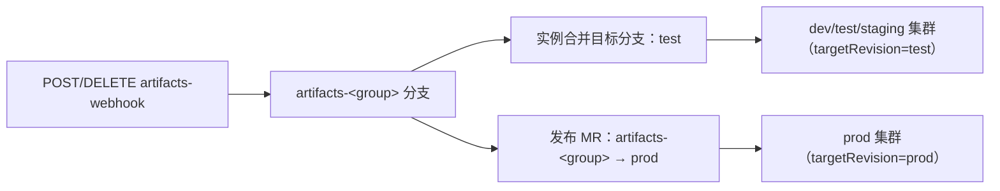

# 更新 GitOps artifacts.libsonnet

## 对象与语义

- 文件位置：GitOps 仓库 `apps/<group>/artifacts.libsonnet`（本仓工作副本在 `repos/gitops/apps/<group>/`）。`<group>` = 目录名 = ArgoCD 应用名 = webhook 的 `namespace`/`group`。
- 结构：`{ "<ACR 仓库名>": { "<环境键>": "<完整 tag>" } }`；环境键是 `dev` / `test` / `staging` / `prod-gray` / `prod`（另有 `IyyyyMMdd`、`Iteration-…`、`emergency-*` 等泳道键，值为字符串=主 workload、对象=多泳道）。
- key 必须等于应用 `app.yaml` 里的 `image:` 值（即 ACR 仓库名），否则渲染取不到镜像。
- 文件头注释是硬约束：**只能在 `artifacts-<group>` 分支修改，再合并到其它分支**。直接在网页/其它分支改会产生合并冲突。

### 渲染门槛与取 key 规则（`repos/gitops/apps/templates/Compose.libsonnet`）

- `:446-452` 的 `isDeploy && hasArtifact` 决定是否渲染该服务：`hasArtifact = resolveArtifactTag(...) != null`，而 `resolveArtifactTag`（`:172-179`）用 `std.get(imgArtifacts, branchKey)` **无默认值**。所以**缺 artifacts 条目 = 该服务被静默过滤**（不报错、也不生成 Rollout/Service/HTTPRoute），整组表现成「没有 workload」。
- 取哪个 key：`getArtifactBranchKey`（`:166-170`）= `clusterParams.artifactsBranch`（即 `clusterType`）再按 `-gray` 后缀补 `-gray`，可用服务的 `branch:` 映射覆盖。
- 镜像地址：`clusterParams.artifactsDomainacr`（`clusterParams.libsonnet` 里硬编码为 `xlb-acr-registry-vpc.cn-hangzhou.cr.aliyuncs.com`）+ `/zc_xlb/<image>:<tag>`。
- 读哪个分支：`argocd/Application.libsonnet:17-22` 的 `targetRevision` 映射为 `{dev: test, test: test, staging: test, prod: prod}`；`path = <group>`、`exclude: '*.app.yaml'`。所以 dev/test/staging 三个集群都读 **`test` 分支**（各集群仍按自己的 `clusterType` 取 key），prod 集群读 **`prod` 分支**。
- 只读预检：`repos/gitops/preview.sh` 可单服务渲染（缺当前集群 tag 时补 `preview-dummy` 占位，仅看配置是否正确）；`repos/gitops/apps/eval.sh` 为含 `*.app.yaml` 的目录生成 `_.jsonnet` 并全量渲染。渲染前先确认 `repos/gitops/clusterName.libsonnet`（决定 `clusterType`；注意其 `assert` 已把旧 `ali-test` 视为下线，正确值形如 `ali-test-136`）。

## 写入路径

| 路径 | 适用 | 关键点 |
| --- | --- | --- |
| **artifacts-webhook**（首选） | 平台/CI/人工补条目 | HTTP，无鉴权；按集群分环境端点；异步队列；写 `artifacts-<group>` 后 merge 进该实例的合并目标分支 |
| CodeUp OpenAPI 直改文件 | 需要写非标准路径或批量重排 | `POST/PUT /oapi/v1/codeup/organizations/<org>/repositories/<repoId>/files...`，头 `x-yunxiao-token`；**坑：`formatStr` 非 `json`/`yaml` 时 `content` 会被写成空串** |
| 人工编辑 + MR | 结构性重排 | 只改 `artifacts-<group>`，不要改 `prod` |

### artifacts-webhook 契约

```bash
# 端点按集群选，禁止跨环境使用；ali-test 就是本仓 config-pri-test.yaml:367 配置的真实入口
WEBHOOK='https://artifacts-webhook.argocd.ali-test.xlbsoft.com'

# 写入/更新一条（upsert）
curl -sS -X POST "$WEBHOOK" -H 'Content-Type: application/json' \
  -d '{"namespace":"<group>","group":"<group>","docker":"<ACR 仓库名>","branch":"<环境键>","image_tag":"<完整 tag>"}'

# 删除一条（按 image_tag 解析出的 iteration_key 精确删除；404 视为幂等成功）
curl -sS -X DELETE "$WEBHOOK" -H 'Content-Type: application/json' \
  -d '{"namespace":"<group>","group":"<group>","docker":"<ACR 仓库名>","branch":"<环境键>","image_tag":"<完整 tag>"}'

curl -sS "$WEBHOOK/api/queues"      # 队列与 history（只读）
```

- `branch` 是**环境键**，不是 feature 分支名；`docker` 是 ACR 仓库名。
- 服务端：目标文件不存在时用 `{}` 建文件并写固定头注释；**`artifacts-<group>` 分支不存在时会从 `refs/heads/base` 新建**（实测：`mart-retail-review` 的 artifacts 分支就是这样由第一次 POST 创建的，父提交是 2024-11 的 `base`）；commit 后 push `artifacts-<group>`，再 merge 进该实例的合并目标分支（实测 ali-test 实例 = `test`），最后异步 refresh ArgoCD 应用 `<namespace>`。
- 端点按集群区分：`https://artifacts-webhook.argocd.<env>.xlbsoft.com`（ali-dev / ali-test / …）。**ali-dev 只允许写测试仓库 `ai/apps.git`**，不要拿它测真实 GitOps；ali-test/staging/prod 一律按生产端点对待。
- **DELETE 的撤销语义有限**：它按 `image_tag` 解析出的 iteration 身份删除；对非 `IyyyyMMdd` 前缀的 legacy tag（如 `prod-…`、`test-…`）不是「删一个环境键」，泳道清理请以 `test-artifacts-webhook-e2e` 的口径为准，撤销 prod/prod-gray 条目优先改 MR/文件而不是 DELETE。
- 服务端源码在本仓 `devops-utils/artifacts-webhook/src/main.rs`（该副本是精简版：只有 `POST /`、目标分支硬编码 `test`；线上版本另有 DELETE 与 `/api/queues`）。

## 发布前必须做的耦合检查

写某个环境键 = 允许该环境的集群部署这套服务。若新组与现网组共用中间件，**并行运行会重复消费**：

```bash
# 逐个环境对比新组与现网组的 app.yaml，Diff 为「完全相同」的项即为共享资源
diff <(sed -n '/^envs:/,/^[a-zA-Z]/p' repos/gitops/apps/<现网组>/<svc>.app.yaml) \
     <(sed -n '/^envs:/,/^[a-zA-Z]/p' repos/gitops/apps/<新组>/<svc>.app.yaml)
```

重点看 `*_DATABASE__HOST`、`*_AUTH_REDIS__HOST`、其它 `*_REDIS__HOST`、`*ROCKETMQ*__ACCESS_URL`、`*_CONSUMER_GROUP`。

判定规则（不要按「环境」整体下结论）：

- 逐 key 比对，**只有两边都是字面值且相同**才算共享。`IAC__…` 这类占位符的实际值不在 GitOps 仓库里（由平台注入），明文 diff 会把「占位符 vs 字面值」误判；需要共享/独立结论时向平台或运维核对注入值。
- 实测（mart-retail-review vs retail-review，sync-worker/risk-worker）：dev/test/staging 的 OceanBase、Redis、RocketMQ 与消费组**全部共享**；prod/prod-gray 的 OceanBase 与业务 RocketMQ **独立**（走 `IAC__MART_*` 注入），但 **`REVIEW__AUTH_REDIS__HOST`（`r-bp1haqafuvrn0eurg1`，db 0，用户 `xlb_prop`）在 prod 与现网组仍然完全相同**——所以「prod 完全隔离」是错误结论。
- 消费组同名 + 中间件共享 = 两组同时在线会**重复消费/互相抢消息**。

同源佐证：`repos/gitops/apps/clusterParams.libsonnet` 自己因「prod-136 与老 prod 集群共用同一套数据库/中间件，定时任务两边同时跑会重复执行」而把 `prod` 的 `cronJobMode` 置为 `'off'`——即**共享中间件导致的重复执行在本仓库是被承认的真实风险**，新组上线同理。

## 标准流程

1. **固定输入**：`group`、`docker`（ACR 仓库名）、环境键集合、完整 tag（逐条）。
2. **前置门槛：镜像必须先存在**。artifacts 里的 tag 必须已在 ACR 就位，否则 Pod 会 `ImagePullBackOff`；用 `acr-image-retag` 的 `--preflight` 或 `GET /v2/zc_xlb/<image>/tags/list` 核对。
3. **只读预检**：读 `artifacts-<group>` 与目标分支的远端文件，确认现有条目；读 `app.yaml` 的 `image:` 与 `deploy:`/`branch:` 映射，确认该环境确实会渲染。
4. **耦合检查**（上文）→ 决定环境范围。
5. **确认授权**：写入会改真实 GitOps 分支并触发 ArgoCD refresh，属变更操作，先给用户确认点。
6. **dry-run**：`scripts/publish_artifact.py --plan plan.json --dry-run`——**只打印将要投递的条目，不校验端点、不校验字段、不触网**，别把它当预检。
7. **投递**：`--plan` 批量 POST；脚本对非 2xx 直接判失败并停止等待，对 2xx 会等到队列终态。
8. **远端回读（必做）**：队列 `status=done` **不等于**写入成功（push 重试耗尽也可能显示 done）。回读 `artifacts-<group>` 分支的文件并确认条目；需要时对比合并目标分支是否一致。
9. **集群侧生效判据**：回读文件后仍要去集群确认——`kubectl get application <group> -n argocd` 的 sync/operationState、以及目标 Rollout 的镜像是否切到该 tag（做法参考 `efficiency/skills/first-prod-release-live-testing.md`）。本机没有集群权限时，明确写「仅完成 GitOps 侧验证」。
10. **收尾**：记录提交 SHA、合并目标分支、未发布的环境与原因、剩余风险；删除临时克隆。

```bash
./scripts/publish_artifact.py --endpoint "$WEBHOOK" \
    --group mart-retail-review --docker mart-review-b --branch prod-gray --tag prod-gray-<sha>-<ts>
./scripts/publish_artifact.py --endpoint "$WEBHOOK" --plan plan.json --dry-run
```

## 分支与生效链路



- webhook **不会**写 `prod` 分支，而且 `repos/gitops/apps/argocd/artifacts-webhook.jsonnet:5` 明确只在 `ali-test` / `ali-dev` 集群下发 webhook（镜像 `gitops-tools/artifacts-webhook:v0.12`）——**prod 侧没有 webhook**，prod 变更天然只能靠 `artifacts-<group> → prod` 的发布 MR（平台 `CreateNsMergeRequest`/`ensureProdGitOpsMerged`）。
- 到 `test` 分支的合并只影响 dev/test/staging 集群的渲染，且各集群只取自己 `clusterType` 对应的 key；因此「只发 prod/prod-gray」在 dev/test/staging 上不会生效，也不会改变它们的期望状态。
- 实测曾出现效能平台自动合并该 MR，使 `prod` 分支领先于后续 webhook 写入，**发布 prod 前务必回读 prod 分支现状**。
- 该 MR 还存在自动放行链：`devops-utils/apps-mr/index.ts` 对 `source_branch` 以 `artifacts-` 开头、目标为 `prod` 的变更请求自动提交「通过/PASS」评审（作者需在联系人白名单内）——所以 `artifacts-<group> → prod` 可能被快速合入，不能假设「推了 artifacts 分支 prod 就不会动」。

## 常见错误（红牌）

| 现象 | 原因 | 处理 |
| --- | --- | --- |
| 队列 `done` 但远端文件没变 | push 重试耗尽仍记 done | 只认远端回读 |
| 合并目标分支写成了 `prod` | 误以为 webhook 会写 prod | prod 走发布 MR |
| 直接编辑 `prod` 分支的 artifacts | 违反文件头约束 | 回到 `artifacts-<group>` 改，再 MR |
| CodeUp 文件 API 写入后文件为空 | `formatStr` 非 `json`/`yaml` | 传结构化内容 + `formatStr="json"` |
| 写入成功但 ArgoCD 不渲染 | `app.yaml` 的 `image:` 与 artifacts key 不一致，或该环境 `deploy: false` | 对齐 key 与 deploy/branch 映射 |
| 发布后与现网服务重复消费 | 新组与现网组共用 DB/Redis/MQ 且消费组同名 | 发布前做耦合检查，按环境分批 |
| 用 ali-dev 端点验证时连到真实 GitOps | 端点选错 | ali-dev 只允许 `ai/apps.git` |

## 安全边界

- 本地工作副本 `repos/gitops/apps/` 只用于只读预检与调试：可改文件、跑 `preview.sh`，但**禁止 `git commit` / `git push`**，也不得借本机改动走 CodeUp API / webhook / MR 反向推送远端（见根 `AGENTS.md`「GitOps 工作副本」）。
- 端点与环境一一对应：测哪个环境就用哪个集群的端点，禁止跨环境。
- 一次只发布约定的环境集合；不要顺手把 dev/test/staging 一起发。
- 回读用只读方式（浅克隆指定分支或 CodeUp 文件读取 API）；临时克隆内含明文配置，用完删除，不要提交、不要贴进文档。
- 凭据/token 不落盘、不回显、不写进 skill。

## 关联

- 镜像本身要先在 ACR 就位：见 `skills/acr-image-retag/SKILL.md`。
- artifacts-webhook 的受控 E2E 测试（泳道 upsert/DELETE、repo-server overlay、分支回读）见 `efficiency/skills/test-artifacts-webhook-e2e/SKILL.md`（只允许 ali-dev + `ai/apps.git`）。