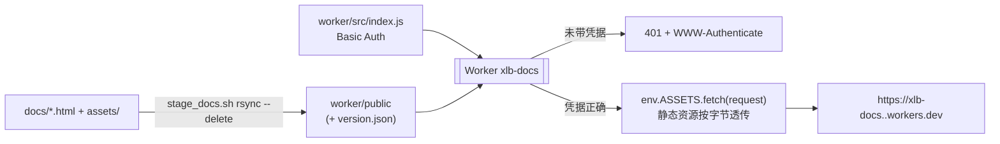

# 文档站 Cloudflare 部署（xlb-docs）

## 一条命令

```bash
skills/cloudflare-docs-deploy/scripts/deploy_docs.sh
```

内容：`docs/` → 暂存到 `worker/public` → 写 `version.json` → `wrangler deploy` → 回读校验（401 门禁、内容哈希、index.html 字节比对）。

## 部署拓扑



- 门禁在同一 Worker 进程里，`assets.run_worker_first=true` 保证**包括 `/assets/*`、`/version.json` 在内的每个请求**都先过鉴权，不存在绕过静态路径。
- 口令只存为 Worker secret `DOCS_PASSWORD`；用户名来自 `wrangler.jsonc` 的 `vars.DOCS_USER`（默认 `xlb`，非敏感）。仓库/源码里没有任何明文口令。

## 核心事实（本机实测）

- **站点地址**：`https://xlb-docs.xinpurezhu.workers.dev`（账号 `Xinpurezhu@gmail.com's Account` / `be46ca9db87b4b07a2e9cbb5bba3197b`，workers.dev 子域 `xinpurezhu`）。项目名 `xlb-docs` 来自 `worker/wrangler.jsonc` 的 `name`。
- **首次部署有顺序约束**：Worker 不存在时 `wrangler secret put DOCS_PASSWORD` 会报 `Worker "xlb-docs" not found`——**必须先 deploy 再设 secret**。`deploy_docs.sh` 已按此处理：Worker 不存在时允许先发布，发布后打印设置口令的提示并以退出码 1 结束；而 Worker 已存在却缺 secret 时直接阻断（防止把缺门禁的版本顶上去）。
- **缺 secret 时是 fail-closed**：`DOCS_PASSWORD` 未设置时 Worker 对**所有**请求返回 `500`（不含任何文档内容），不会退化成公开站点。
- **本机网络直连不了 `*.workers.dev`（实测）**：该域名在此网络被 DNS 污染 + SNI 阻断——`dig xlb-docs.xinpurezhu.workers.dev` 返回 `66.220.147.11` / `108.160.166.9` 这类无关 IP；直连 `curl` 报 `Failed to connect ... port 443`；`curl --resolve <workers.dev 主机>:443:104.16.124.96`（Cloudflare 边缘 IP）也被 `Connection reset by peer`。
  - **`wrangler deploy` 不受影响**（走 `api.cloudflare.com`，可正常发布，实测成功）。
  - **校验与浏览器访问都要走代理**：本机已有代理监听 `127.0.0.1:7890`，`export https_proxy=http://127.0.0.1:7890` 后一切正常（HTTP/2 200）。脚本内的 curl 会自动识别 `https_proxy`/`HTTPS_PROXY`/`ALL_PROXY`；未设代理时用 `--connect-timeout 10 --max-time 60` 快速失败并给出上述提示，不会挂住。
  - 想在无代理的国内网络直接访问，需要给 Worker 绑自定义域名（本 skill 未覆盖）。
- **`/` 与 `.html` 的行为**：`html_handling: auto-trailing-slash`（Cloudflare 默认）下，`GET /` → `200` 直接返回 `index.html`（无跳转）；`GET /01-xxx.html` → `307 Location: /01-xxx` → `200`，浏览器自动跟随（1 次额外跳转，页面内容正确）。
  - **不要把 `html_handling` 改成 `none`**：实测 `/` 会变成 `404`（`/index.html` 才 200），而站内导航与首页入口都用 `/`。
- **静态资源是逐字节透传**：`curl -u xlb:<pw> $URL/index.html | shasum -a 256` 与本地 `docs/index.html` 完全一致（index 与子页均已验证）。因此“远端 == 本地 docs”可以按 SHA-256 下结论，不必靠肉眼。
- **`compatibility_date` 必须 ≤ 本机 wrangler 自带 workerd 的上限**：wrangler 4.115.0 的上限是 `2026-07-29`。写成未来的 `2026-10-16` 时 `wrangler deploy --dry-run` 照样成功，但 `wrangler dev` 启动即失败（`This Worker requires compatibility date ... but the newest date supported by this server binary is ...`）。本 skill 钉在 `2026-07-29`，无需新特性。
- **`version.json`（部署元数据，需口令）**：`{project, content_hash, files, git_commit, docs_dirty, built_at}`。`content_hash` 是暂存目录所有文件路径+SHA-256 的聚合值（前 16 位），用来回答“线上跑的是不是这份 docs”。
- **`docs_dirty`**：`docs/` 相对 git HEAD 有改动时为 `true`（本工作区常态：文档常是未提交状态，不影响部署口径）。
- **免费额度**：单文件 ≤ 25 MiB、文件数 ≤ 2 万；当前 docs 为 35 个文件 / 4.4 MB（含自托管 mermaid.min.js 3.4 MB）。
- **首次使用 Workers**：账号若从未开过 workers.dev 子域，`wrangler deploy` 会引导注册一次（项目名 `xlb-docs` → `https://xlb-docs.<子域>.workers.dev`）。免费计划支持 Workers + 静态资源。

## 首次搭建（只做一次）

```bash
# 1) 登录（浏览器 OAuth；非交互环境只能用 CLOUDFLARE_API_TOKEN，需 Workers Scripts:Edit）
! wrangler login

# 2) 首次部署（此时 Worker 还不存在，secret 只能发布后再设；脚本会打印口令设置提示并以退出码 1 结束）
#    本机网络直连不了 *.workers.dev，校验要走代理：export https_proxy=http://127.0.0.1:7890
skills/cloudflare-docs-deploy/scripts/deploy_docs.sh

# 3) 设置访问口令（口令不打进仓库、不上屏；Worker 必须先存在，改口令重复执行即可）
! printf '%s' '<口令>' | wrangler secret put DOCS_PASSWORD \
    --config skills/cloudflare-docs-deploy/worker/wrangler.jsonc

# 4) 复跑一次拿到完整校验（401 门禁 / 带凭据 200 / 内容哈希 / index.html 字节）
export https_proxy=http://127.0.0.1:7890
export DOCS_PASSWORD='<口令>'   # 仅本 shell 内，供脚本做带凭据校验；不写入任何文件
skills/cloudflare-docs-deploy/scripts/deploy_docs.sh
```

- 口令设置**不需要**重新 deploy：Worker 在请求时读取 secret，`wrangler secret put` 生效后立刻可访问（实测删除 secret 后站点立即回到 500，重新设置后立即恢复）。

## 日常：文档更新后同步部署

```bash
# 1) 改完 docs/（遵循 docs/文档格式规范.md）
# 2) 同步部署（本机网络需代理访问 workers.dev 校验；不想校验时加 --skip-verify）
export https_proxy=http://127.0.0.1:7890   # 仅在「直连 workers.dev 不通」的网络上需要
skills/cloudflare-docs-deploy/scripts/deploy_docs.sh
```

- 脚本用 `rsync -a --delete`：**docs/ 里删掉的文件在站点上也会消失**，不会残留旧页面。
- 自带校验与凭据无关的部分（401 门禁）始终执行；若导出 `DOCS_PASSWORD`（`export DOCS_PASSWORD='<口令>'`）则额外做带凭据 200、`version.json` 哈希比对与 `index.html` 字节比对。
- 本地预览（同款门禁，口令默认 `xlb-docs-dev`，端口 8787）：`skills/cloudflare-docs-deploy/scripts/serve_local.sh`。

## 命令表

| 命令 | 作用 | 是否需要登录/口令 |
| --- | --- | --- |
| `scripts/stage_docs.sh` | 只做暂存 + 写 `version.json`，stdout 只回 `content_hash` | 都不要 |
| `scripts/deploy_docs.sh` | 暂存 + 发布 + 回读校验（首次部署允许缺 secret，发布后提示补设并 exit 1） | 需 wrangler 登录；已存在 `DOCS_PASSWORD` 才会做完整校验 |
| `scripts/deploy_docs.sh --dry-run` | 只本地打包（`wrangler deploy --dry-run`），不发布 | 都不要 |
| `scripts/serve_local.sh` | 本地 127.0.0.1:8787 预览带门禁站点 | 都不要 |
| `wrangler secret list`（在 `worker/`） | 看 secret 是否存在（不回显值） | 需登录 |
| `DOCS_URL=<url> scripts/deploy_docs.sh` | 覆盖自动解析的站点 URL | — |

## 排错

| 现象 | 原因 / 处置 |
| --- | --- |
| `Not logged in. Your auth token has expired...` | 本机 wrangler 登录态失效：`wrangler login`，或导出 `CLOUDFLARE_API_TOKEN` |
| 直连站点超时 / `Failed to connect ... port 443` | 本机网络对 `*.workers.dev` 做了 DNS/SNI 阻断（与部署无关）：`export https_proxy=http://127.0.0.1:7890` 后重跑脚本；浏览器同样要挂代理 |
| `wrangler secret put` 报 `Worker "xlb-docs" not found` | 首次发布的顺序约束：Worker 还不存在，先跑 `deploy_docs.sh` 发布，再设 secret |
| 站点对任何请求都返回 500 | `DOCS_PASSWORD` 缺失（fail-closed，不泄露内容）：设置口令即可生效，**无需重新 deploy** |
| 脚本报「Worker xlb-docs 已存在但缺少 DOCS_PASSWORD secret，中止发布」 | 异常状态（已发布的 Worker 缺门禁）：按提示在 `worker/` 下 `printf '%s' '<口令>' \| wrangler secret put DOCS_PASSWORD` 后重跑 |
| `wrangler dev` 报 compatibility date 不被支持 | 把 `compatibility_date` 下调到 ≤ 本机 wrangler 支持上限（当前 `2026-07-29`） |
| 站点 401 但口令确认无误 | Basic Auth 凭据被浏览器缓存旧值（换过口令后必现）：关闭浏览器重开，或改用无痕窗口；口令含非 ASCII 时也可能因浏览器编码差异失败，建议 ASCII |
| 部署成功但页面还是旧的 | 看回读校验的 `content_hash`：不一致说明部署的不是当前 docs/；一致则是浏览器缓存，强刷 |
| 改动 docs 后站点没变 | 没跑 `deploy_docs.sh`；或 `DOCS_URL` 指向了别的 Worker |
| 未带凭据也返回 200 | 门禁失效：确认 `wrangler.jsonc` 的 `assets.run_worker_first` 仍为 `true`，且 `DOCS_PASSWORD` 已设置（缺 secret 时 Worker 返回 500 而非放行） |

## 安全边界（须向使用方说明）

- **共享口令，Basic Auth**：不能按人审计、无账号体系；Cloudflare 侧只有基础防护，Worker 内**未做失败次数限流**。因此口令必须足够长（≥ 20 位随机串），且不要在多个系统复用。
- docs 内含命名空间、服务清单、事故复盘等内部信息，**默认不上任何搜索引擎索引**：Worker 对所有响应加 `X-Robots-Tag: noindex, nofollow, noarchive`。
- 仅 `*.workers.dev` 域，未绑定自定义域名；若后续要“按人授权 + SSO”，改走 Cloudflare Access（本 skill 未覆盖）。
- 任何脚本/日志都不得回显口令；`wrangler secret put` 从 stdin 读，`deploy_docs.sh` 只读环境变量、不打印。